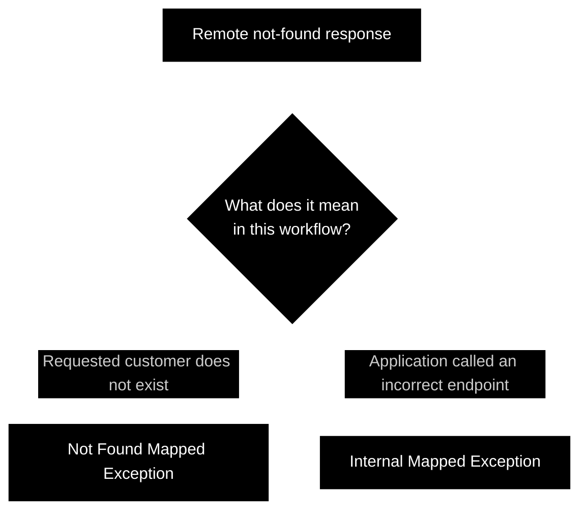
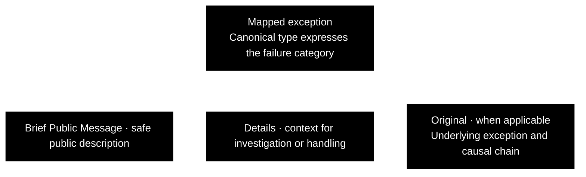
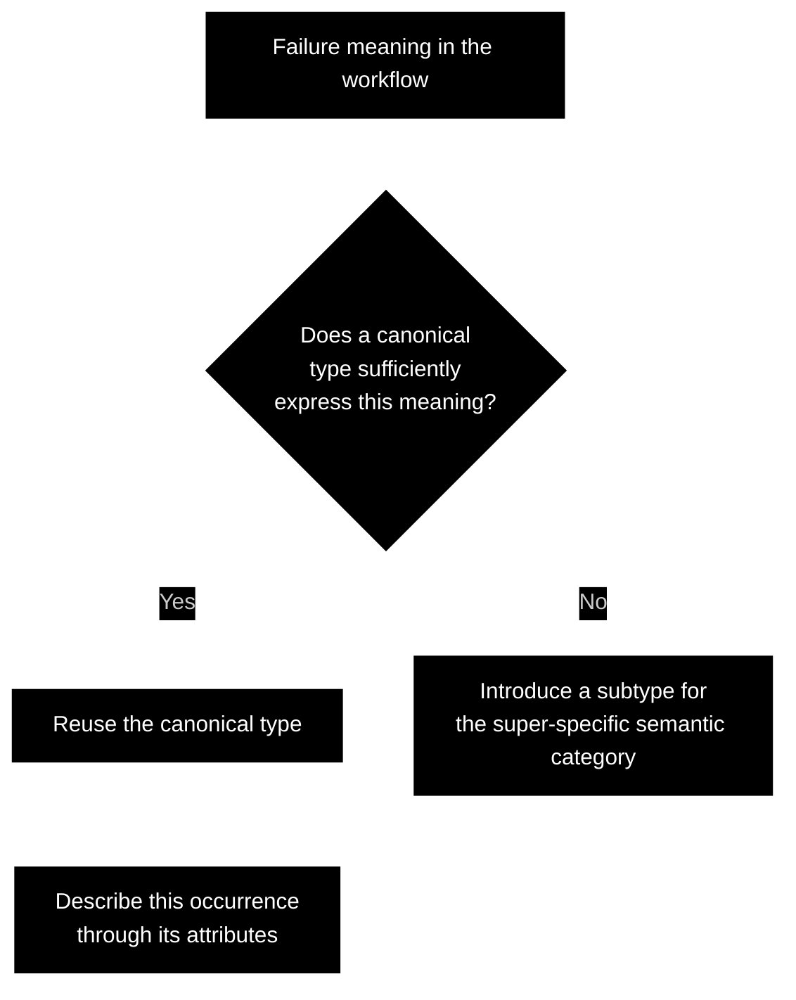

CAE Concept

---

 

## Clean Mapped Exceptions

This concept defines a common vocabulary for failures within application workflows.

A **mapped exception** expresses what a failure means in its workflow context. Its type identifies the failure category; its contextual information describes the specific occurrence.

Mapping allows callers and diagnostic tools to reason about failures without depending on their underlying technical representation.

### Canonical Types

Five canonical types express recurring failure categories:

- **Input Mapped Exception**: supplied input does not meet the workflow's requirements.
- **Internal Mapped Exception**: execution cannot proceed because of an internal or dependency problem.
- **Not Found Mapped Exception**: a resource expected by the workflow could not be found.
- **Not Authorized Mapped Exception**: an identified actor lacks permission for the requested action.
- **Not Authenticated Mapped Exception**: the required actor identity has not been established.

### Classification in Context

It is the workflow orchestrator that determines classification.

For example, a remote not-found response may indicate that the requested customer does not exist, or that the application called an incorrect endpoint. Those circumstances may justify a Not Found Mapped Exception and an Internal Mapped Exception, respectively.

The appropriate canonical type therefore depends on what the failure means for the workflow, rather than the technical error alone.

### Attributes

Each canonical type carries attributes that describe the specific failure: a brief public message, details, and the original exception, when applicable.

#### Brief Public Message

A concise, human-readable description intended to be safe for public exposure.  It communicates the failure without sensitive information or unnecessary implementation details.

#### Details

Context used to understand, diagnose the failure. It may contain technical or sensitive information.
The public message explains the failure to its audience; details support deeper investigation or programmatic handling.

#### Original

The underlying exception that caused the mapped failure, when one exists. Preserving it retains the causal chain and diagnostic information, such as the original stack trace.

### Reuse and Specialization

The canonical types are intended for reuse across workflows, languages, and technologies.

Reusing these types standardizes how failures are expressed, reducing both the manual effort and AI token costs involved in defining, documenting, and interpreting separate exception types for equivalent meanings. The vocabulary is defined once and reused wherever those meanings apply.

Contextual information (category and internal data) usually provides sufficient specialization. Additional exception types are appropriate when callers need a super-specific semantic type that the existing ones cannot express.

### A Common Failure Vocabulary

Canonical types give recurring failures a consistent meaning, while their attributes describe each occurrence. Workflow context guides the choice of type, with additional types reserved for meanings the existing vocabulary cannot express.

This makes reusing canonical types a practical approach to mapping exceptions: each workflow expresses its failures through an established vocabulary, reducing both the manual effort and AI token costs of defining and interpreting equivalent failure meanings repeatedly.

 

---

clean software, made easy.

